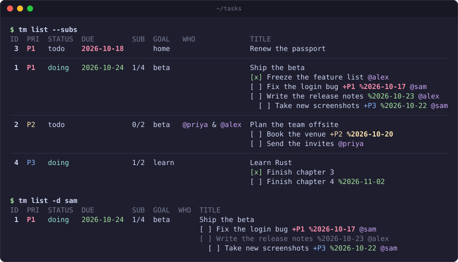

# tm

A minimal CLI task manager. Goals live in one markdown file and each task is
its own markdown file. The files are the source of truth, so edit them in editor
whenever that's quicker than the CLI.

Standard library only, no dependencies. Written for Python 3.9+.



## Install

1. Clone the repo into `~/.task-manager`:

   ```sh
   git clone https://github.com/sud0x0/task-manager ~/.task-manager
   ```

2. Add these lines to `~/.zshrc` (or `~/.bashrc`). The first sets where your
   tasks are stored; the second puts `tm` on your `PATH`:

   ```sh
   export TM_HOME="$HOME/tasks"
   export PATH="$HOME/.task-manager/bin:$PATH"
   ```

3. Reload your shell and create the task folder:

   ```sh
   source ~/.zshrc
   tm init
   ```

To update later, run `git -C ~/.task-manager pull`.

## File Structure

```
~/tasks/
  goals.md                              all goals
  tasks/
    0001-rewrite-the-deploy-script.md   one file per task; 0001 is its id
```

A task:

```markdown
---
id: 1
title: Rewrite the deploy script
status: todo
priority: P1
goal: ship-v1
delegated_to: @alice
start: 2026-10-10
due: 2026-10-17
done_at:
---

Description goes here.

## Sub-todos

- [x] Audit the current script @bob
- [ ] Write the replacement +P1 %2026-10-15

## Comments

### 2026-10-10 14:02

Blocked on ops access.
```

- `status`: `todo`, `doing`, `blocked`, `done` or `cancelled`
- `priority`: `P1` (highest), `P2` (default) or `P3`
- `goal`: a slug from `goals.md`
- dates are `YYYY-MM-DD`; `done_at` is filled in by `tm done`
- **Sub-todos must be checkboxes:** `- [ ] open`, `- [x] done`. Spacing inside
  the brackets doesn't matter. Indent to nest (two or four spaces). A plain
  `- task` bullet is not a sub-todo.
- **Sub-todo extras**, in any order: `+P1` (or `+1`) for priority, `%2026-10-20`
  for a target date, `@who` for people — `- [ ] Draft it +P1 %2026-10-20 @bob`.
  In `tm add` the date can also be `%fri` or `%+3d`.
- **Delegating to several people:** `@x & @y`, `@x, @y` or `@x and @y`, in
  `delegated_to` or in a sub-todo.

A goal in `goals.md`:

```markdown
## Ship v1 of the task manager

slug: ship-v1
status: active

Description goes here.
```

Goal `status` is `active`, `achieved` or `dropped`.

**Hand edits are safe.** When `tm` rewrites a file it keeps everything you
added: extra keys, extra `##` sections, notes between sub-todos. If it can't
fully parse a file, it refuses to rewrite it and tells you which line to fix.

## Commands

```sh
tm goal add "Ship v1" --slug ship-v1
tm goal list
tm goal show ship-v1

tm add "Rewrite the deploy script" -p 1 -g ship-v1 --due +7d
tm add                          # no title: write the task in $EDITOR

tm list                         # open tasks, highest priority first
tm list --all                   # include done and cancelled
tm list --subs                  # every task with all its sub-todos
tm list -g ship-v1 -s doing     # filter by goal or status
tm list -p P1                   # P1 tasks and +P1 sub-todos
tm list -d bob                  # everything mentioning @bob
tm list --overdue               # past their date; --today adds due today
tm list -d bob --overdue        # combine filters to narrow down
tm list --sort due              # or priority (default), id, title, goal

tm show 1
tm edit 1                       # open the file in $EDITOR
tm comment 1 "Blocked on ops access."
tm done 1
tm status 1 blocked             # task number, then the new status

tm goal set-status ship-v1 achieved
tm check                        # validate every file
```

`-p`, `-d`, `--overdue` and `--today` also look inside sub-todos, at any depth.
A matching sub-todo is listed under its task, with the items above it dimmed.
A sub-todo has to match every filter you give, and it doesn't inherit its
task's priority or date.

Dates can be `2026-10-17`, `today`, `tomorrow`, `+3d`, `+2w` or a weekday
like `fri`. Every command takes `-h`, and `--root PATH` overrides `TM_HOME`.

## Good to know

- Writes are atomic: an interrupted write never leaves half a file.
- `tm edit` never throws away what you typed. If the saved file is invalid, it
  says what's wrong and leaves the file as you saved it.
- If `tm add` can't use what you wrote, your draft is kept and its path printed.
- Ids are never reused.
- `$TM_EDITOR`, then `$VISUAL`, then `$EDITOR`, then `vim`.
- Colors: P1 red, P2 yellow, P3 blue. Dates are red when overdue, yellow when
  due today, green otherwise, and dimmed once the work is done. `@people` are
  magenta.

## Tests

```sh
python3 -m unittest discover -s tests -t . -v
```
